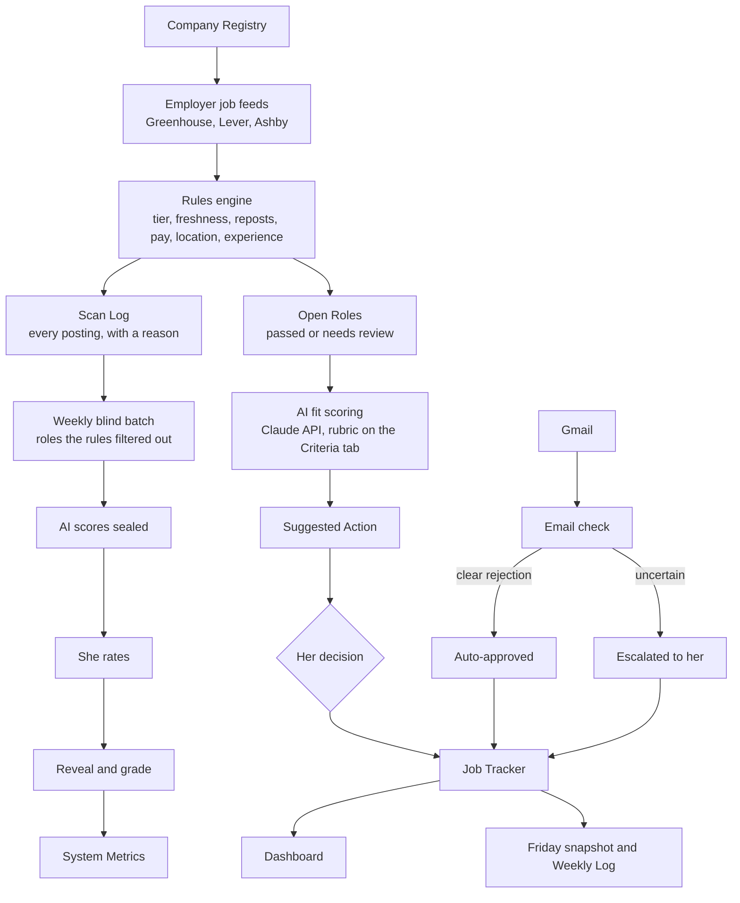

# Architecture

The Google Sheet is the system of record. Apps Script runs on time-based triggers; every automated write lands in a visible column, and every decision column belongs to the person.

## Schedules (America/New_York)

| Time | Job |
|---|---|
| Mon/Wed/Fri about 7 AM | Scan |
| Mon/Wed/Fri about 8 AM | Email check |
| Mon/Wed/Fri about 9 AM | AI scoring of new Open Roles |
| Monday about 10 AM | Blind batch draw |
| Friday 5 PM | Weekly snapshot |

## Contracts that keep it safe

- **Columns are found by header text,** not position, so inserting a column cannot silently break a script. A renamed header fails with a clear error.
- **Scripts propose; formulas decide; the person overrides.** The email check never writes the decision column. Auto-approval is a Sheet formula, visible and auditable.
- **Frozen audit columns** record the recommendation and AI score at the moment of each decision.
- **Atomic writes:** multi-step Sheet changes are applied all-or-nothing.
